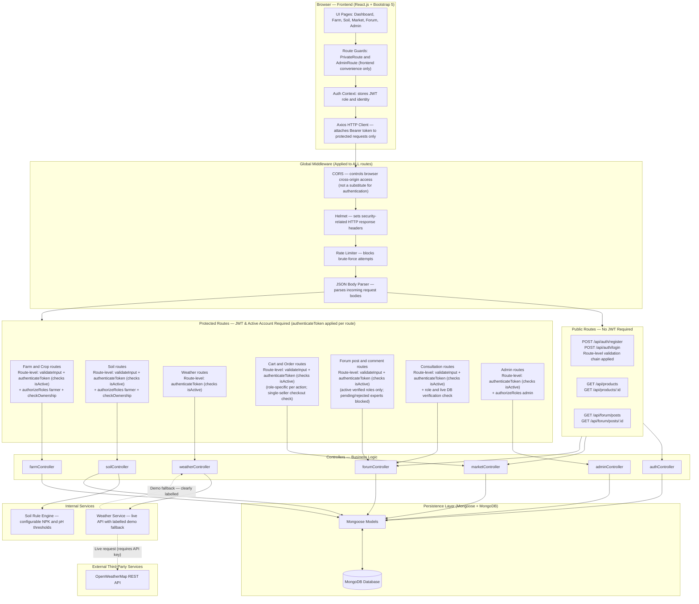
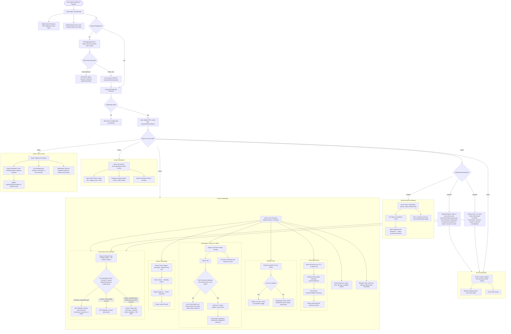
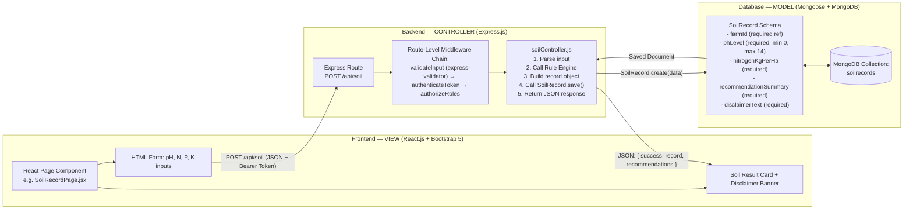

# AgriTech — Finalized Architecture Documentation
**Project:** AgriTech – Empowering Farmers Through Digital Technology  
**Stack:** MERN (MongoDB · Express.js · React.js · Node.js) + Bootstrap 5 + JWT  
**Document Version:** 2.3 — Final Review Completed  
**Last Updated:** 2026-10-31  

---

> **How to read this document**
> Each section is self-contained and written in plain language first, followed by technical detail.
> Mermaid diagrams are embedded in fenced code blocks and render in GitHub, VS Code Preview,
> and any Mermaid-compatible viewer.

---

## Table of Contents

1. [Technical Architecture](#1-technical-architecture)
2. [Entity Relationship (ER) Diagram](#2-entity-relationship-er-diagram)
3. [Features and Functionalities](#3-features-and-functionalities)
4. [Roles and Responsibilities](#4-roles-and-responsibilities)
5. [Complete User Flow](#5-complete-user-flow)
6. [MVC Architecture Pattern](#6-mvc-architecture-pattern)

---

## 1. Technical Architecture

### 1.1 Plain-Language Overview

Think of the application as three separate layers talking to each other:

- **Frontend (what the farmer sees):** A React.js web app styled with Bootstrap 5.
  The farmer opens it in a browser, fills in forms, and sees weather cards, crop tables,
  and marketplace listings. It never stores data itself — it always asks the backend.

- **Backend (the brain):** A Node.js/Express.js server running on the server machine.
  It receives the frontend's questions, checks whether the user is logged in and allowed
  to do what they are asking, runs the business logic, and fetches or stores data.

- **Database (the memory):** A MongoDB database that persistently stores all users,
  farms, crops, products, orders, forum posts, and consultation records.

External services (e.g., OpenWeatherMap API) are called only from the backend,
so API keys are never exposed to the browser.

---

### 1.2 Architecture Diagram

> **Route-Level Authentication Model:**  
> Authentication and authorisation middleware are applied **per route**, not globally.
> Public routes (register, login, browse marketplace, view forum) do not require a JWT.
> Protected routes apply `authenticateToken` individually, which verifies the JWT signature
> and immediately checks the user's live `isActive` status in the database (returning `403 Forbidden`
> if deactivated). Ownership checks are applied only on routes where a user could otherwise
> access another user's private records.



---

### 1.3 Layer-by-Layer Explanation

| Layer | Technology | Responsibility |
| :--- | :--- | :--- |
| **Frontend** | React.js, Bootstrap 5, Axios | Renders views, manages local UI state. Attaches JWT only to requests that require authentication. Public pages (marketplace browse, forum read) make unauthenticated requests |
| **Global Middleware** | Express.js, Helmet, CORS, Rate Limiter | Applied to all routes: JSON body parsing, CORS cross-origin policy, Helmet security response headers, and rate limiting. Does **not** include `express-validator`; validation chains are applied per route |
| **Route-Level Validation** | `express-validator` chains | Applied individually on each route that accepts user input (register, login, add farm, log soil, post forum, place order, etc.). Not applied globally |
| **Route-Level Auth** | `authenticateToken`, `authorizeRoles`, `checkOwnership` | Applied individually on protected routes only. Public routes skip these. `authenticateToken` verifies the JWT signature (returns `401 Unauthorized` if invalid/expired) and queries the database to confirm the user's account is active (`isActive: true`; returns `403 Forbidden` if deactivated). Ownership checks are applied only where one user could access another's private records |
| **Controllers** | Node.js, Express.js | Coordinates business logic between services and the database |
| **Services** | Custom JS modules | Soil rule engine, weather client with live/demo switching |
| **Database** | Mongoose, MongoDB | Validates schema, stores and retrieves documents |
| **External APIs** | OpenWeatherMap (free tier) | Provides real-time weather. Called only from the backend |

---

### 1.4 Security Architecture Highlights

| Concern | Mechanism |
| :--- | :--- |
| Password storage | `bcrypt` hash (minimum 10 salt rounds). Plaintext never stored or logged |
| Session identity | Signed JWT token `{ userId, role, expertVerificationStatus }`, 24-hour expiry |
| Token transport | **`Authorization: Bearer <token>` HTTP header only.** The Axios client attaches this header on every protected request. The `httpOnly` cookie alternative is not used in this project to keep the implementation consistent across web and potential future API clients |
| NoSQL injection prevention | MongoDB does not use SQL, so SQL injection does not apply. The equivalent risk in MongoDB is **operator injection** — attackers sending `$gt`, `$ne`, `$where`, or similar MongoDB query operators inside request bodies to manipulate queries. The backend must: (1) validate and allowlist accepted fields using `express-validator` on each relevant route; (2) construct all database queries explicitly using known, safe values — never pass a raw `req.body` or untrusted object directly as a MongoDB query filter; (3) use Mongoose typed schemas as an additional safety layer, but not as a sole defence — strict schemas reduce risk but do not replace explicit input validation and query construction |
| CORS and Helmet | **CORS** controls which browser origins are permitted to call the API. It is a browser-enforced policy and does **not** protect against direct server-to-server requests, authenticated malicious actors, or replace CSRF protection. **Helmet** sets security-related HTTP response headers (e.g., `X-Content-Type-Options`, `X-Frame-Options`). Neither CORS nor Helmet replaces backend authentication or authorisation — a request from an allowed origin still requires a valid JWT on every protected route |
| Admin account creation | Admin accounts cannot be registered via the public `/api/auth/register` endpoint. Created only via `npm run seed:admin` using environment variables |
| Admin route lockdown | Every `/api/admin/*` route applies `authenticateToken` followed by `authorizeRoles('admin')` at the route level. A request with a missing or invalid token returns `401 Unauthorized`. A request with a valid token for a non-admin role returns `403 Forbidden` |
| Deactivated account protection | Every protected request verifies the user's current `isActive` status in the database immediately after JWT verification. If an admin deactivates an account (`isActive: false`), all subsequent protected requests are rejected with `403 Forbidden`, even if the JWT signature is valid and unexpired. This takes effect on the very next request without requiring user logout or token expiry. Public read-only routes (browsing products, reading forum threads) remain accessible |
| Expert gating | Consultation-answer routes apply `authenticateToken` + a dedicated `requireVerifiedExpert` check. This check queries the **database** for the expert's current `expertVerificationStatus` — it does not rely solely on the value embedded in the JWT, which may be stale if an admin has since approved or rejected the account. An invalid or expired token returns `401 Unauthorized`. A valid token for a non-expert or unverified expert returns `403 Forbidden`. Admin approval or rejection takes effect immediately on the next request |
| Ownership protection | `checkOwnership` middleware is applied only on routes where it is needed (farm, crop, soil, order routes). It prevents Horizontal Privilege Escalation (IDOR) by confirming the requesting user's `userId` matches the record's owner field before the controller runs |

---

## 2. Entity Relationship (ER) Diagram

### 2.1 Plain-Language Overview

An ER diagram shows all the data tables in the system (called "entities") and the
lines between them show how they connect.

For example:
- One **User** can own many **Farms** (one-to-many).
- One **Order** is always broken into one or more **OrderItems** — each item stores
  a snapshot of `orderId`, `productId`, `quantity`, and `unitPrice` at the moment of
  purchase, so price changes later do not corrupt historical order records.
- A **Product** always carries a `sellerId` pointing to the User who listed it —
  so the system knows whose product it is and who receives orders for it.

---

### 2.2 ER Diagram

```mermaid
erDiagram
    USERS ||--o{ FARMS : "registers"
    USERS ||--o{ PRODUCTS : "sells (sellerId)"
    USERS ||--o| CARTS : "owns zero or one"
    USERS ||--o{ ORDERS : "places (buyerId)"
    USERS ||--o{ FORUM_POSTS : "authors"
    USERS ||--o{ FORUM_COMMENTS : "writes"
    USERS ||--o{ CONSULTATIONS : "submits as farmer (farmerId)"
    USERS |o--o{ CONSULTATIONS : "answers as expert (expertId)"

    FARMS ||--o{ CROPS : "cultivates"
    FARMS ||--o{ SOIL_RECORDS : "tracks"

    CARTS ||--o{ CART_ITEMS : "contains"
    PRODUCTS ||--o{ CART_ITEMS : "added into"

    ORDERS ||--|{ ORDER_ITEMS : "contains"
    PRODUCTS ||--o{ ORDER_ITEMS : "purchased as"

    FORUM_POSTS ||--o{ FORUM_COMMENTS : "receives"
    CROPS ||--o{ CONSULTATIONS : "linked to"

    USERS {
        ObjectId _id PK
        string name "Required"
        string email "Required - Unique"
        string passwordHash "Required - bcrypt"
        string role "Required: farmer | expert | vendor | buyer | admin"
        string phone "Required"
        string district "Required"
        string state "Required"
        string expertLicenseNumber "Optional - Expert only"
        string expertSpecialization "Optional - Expert only"
        string expertVerificationStatus "Required: none | pending | verified | rejected"
        boolean isActive "Required - Default true"
        date createdAt "Required"
    }

    FARMS {
        ObjectId _id PK
        ObjectId farmerId FK "Required -> USERS"
        string farmName "Required"
        number totalArea "Required"
        string areaUnit "Required: acres | hectares"
        string soilType "Required: alluvial | black | red | clay | sandy"
        string irrigationType "Required: drip | sprinkler | rain-fed | canal"
        string district "Required - for weather lookup"
        string state "Required"
        date createdAt "Required"
    }

    CROPS {
        ObjectId _id PK
        ObjectId farmId FK "Required -> FARMS"
        string cropName "Required"
        string variety "Optional"
        date sowingDate "Required"
        date expectedHarvestDate "Optional"
        string currentStage "Required: sowing | vegetative | flowering | harvesting"
        string status "Required: active | harvested | failed"
        date createdAt "Required"
    }

    SOIL_RECORDS {
        ObjectId _id PK
        ObjectId farmId FK "Required -> FARMS"
        date testDate "Required"
        number phLevel "Required - scale 0 to 14"
        number nitrogenKgPerHa "Required - kg per hectare"
        number phosphorusKgPerHa "Required - kg per hectare"
        number potassiumKgPerHa "Required - kg per hectare"
        number organicCarbonPercent "Optional"
        string recommendationSummary "Required - auto-generated"
        string disclaimerText "Required - indicative advisory notice"
        date createdAt "Required"
    }

    PRODUCTS {
        ObjectId _id PK
        ObjectId sellerId FK "Required -> USERS"
        string title "Required"
        string description "Required"
        string category "Required: seeds | fertilizers | equipment | produce"
        number price "Required"
        string unit "Required: kg | quintal | liter | piece | bag"
        number stockQuantity "Required"
        string imageUrl "Optional"
        boolean isAvailable "Required - Default true"
        date createdAt "Required"
    }

    CARTS {
        ObjectId _id PK
        ObjectId userId FK "Required - Unique -> USERS"
        date updatedAt "Required"
    }

    CART_ITEMS {
        ObjectId _id PK
        ObjectId cartId FK "Required -> CARTS"
        ObjectId productId FK "Required -> PRODUCTS"
        number quantity "Required"
        date addedAt "Required"
    }

    ORDERS {
        ObjectId _id PK
        ObjectId buyerId FK "Required -> USERS"
        number totalAmount "Required"
        string status "Required: pending | confirmed | shipped | delivered | cancelled"
        string deliveryAddress "Required"
        string contactPhone "Required"
        date createdAt "Required"
    }

    ORDER_ITEMS {
        ObjectId _id PK
        ObjectId orderId FK "Required -> ORDERS"
        ObjectId productId FK "Required -> PRODUCTS"
        number quantity "Required"
        number unitPrice "Required - snapshot at time of purchase"
    }

    FORUM_POSTS {
        ObjectId _id PK
        ObjectId authorId FK "Required -> USERS"
        string title "Required"
        string content "Required"
        string tag "Required: pest-control | irrigation | fertilizer | general"
        number upvotes "Required - Default 0"
        boolean isModerated "Required - Default false"
        date createdAt "Required"
    }

    FORUM_COMMENTS {
        ObjectId _id PK
        ObjectId postId FK "Required -> FORUM_POSTS"
        ObjectId authorId FK "Required -> USERS"
        string comment "Required"
        boolean isExpertAnswer "Required - Default false"
        date createdAt "Required"
    }

    CONSULTATIONS {
        ObjectId _id PK
        ObjectId farmerId FK "Required -> USERS"
        ObjectId expertId FK "Optional -> USERS - assigned on pickup"
        ObjectId cropId FK "Optional -> CROPS - linked crop"
        string querySubject "Required"
        string queryDescription "Required"
        string attachedImageUrl "Optional"
        string expertResponse "Optional - filled when answered"
        string status "Required: open | assigned | answered | closed"
        date createdAt "Required"
        date answeredAt "Optional"
    }
```



---

### 2.3 Key Relationship Decisions Explained

| Design Decision | Reason |
| :--- | :--- |
| `ORDER_ITEMS` stores both `orderId` AND `unitPrice` | Preserves price at time of purchase. If a seller changes the price tomorrow, old orders stay accurate |
| `PRODUCTS.sellerId` references `USERS` | Identifies who owns each listing — used for seller dashboards and order routing |
| `CARTS` is a separate entity, not local storage | Each user has **zero or one** persistent cart. A cart is only created when the user first adds an item. The `userId` field on `CARTS` carries a unique database index, enforcing this constraint at the database level. The ER notation `USERS \|\|--o\| CARTS` reads as "one user to zero or one cart". Cart items are stored in the related `CART_ITEMS` collection |
| `expertVerificationStatus` on `USERS` | Controls whether an expert can answer consultations. Admin changes this field to grant or revoke access |
| `CONSULTATIONS.expertId` is Optional | Each consultation has exactly one mandatory farmer (`USERS \|\|--o{ CONSULTATIONS`), but zero or one assigned expert (`USERS \|o--o{ CONSULTATIONS`). When a farmer first submits a query, `expertId` is unassigned (status: 'open'). A verified expert can handle multiple consultations; `expertId` is populated only when an expert accepts or answers the ticket |
| `disclaimerText` on `SOIL_RECORDS` | Permanently stores the advisory disclaimer text alongside each record for traceability |

---

## 3. Features and Functionalities

### 3.1 Module 1 — User Registration, Authentication & Profile Management

**What it does in plain language:**  
Allows anyone to create an account and log in securely. The system recognises who you
are and what you are allowed to do, and directs you to the correct dashboard.

**Detailed Functionalities:**
- Public registration with role selection: `farmer`, `expert`, `vendor`, or `buyer`.
  The `admin` role is blocked from this form.
- Secure password hashing on the backend (bcrypt, ≥10 rounds) before saving to the database.
- Login returns a signed JWT containing `{ userId, role, expertVerificationStatus }`.
- Role-based automatic redirect after login:
  - Farmer → Farm Dashboard
  - Expert (Verified) → Consultation Queue
  - Expert (Pending/Rejected) → Limited Read-Only View
  - Vendor → Seller Dashboard
  - Buyer → Marketplace
  - Admin → Admin Control Panel
- Profile view and edit: name, phone, district, state, and profile picture.
- Experts additionally fill in license number and specialization during registration
  (stored for admin review).
- Admin seed script (`npm run seed:admin`) creates admin accounts securely from
  environment variables.

---

### 3.2 Module 2 — Farmer Profile & Farm Management

**What it does in plain language:**  
Lets farmers register the land they own. They describe each plot: how big it is,
what kind of soil it has, and how it is irrigated. They can register multiple farms.

**Detailed Functionalities:**
- Add, view, edit, and delete farm plot records.
- Each farm stores: name, total area (acres or hectares), soil type, irrigation type,
  and location (district + state for weather lookups).
- Farmers can manage multiple farm plots from one account.
- Farm overview card summarizes total registered acreage and active crop count.
- Farm records are strictly private — only the owner and admins can see them.

---

### 3.3 Module 3 — Crop Monitoring & Soil Health Analysis

**What it does in plain language:**  
Lets farmers track what they are growing and record soil test results. The system
reads the soil numbers and gives simple, helpful guidance (not a certified diagnosis).

**Detailed Functionalities:**

**Crop Monitoring:**
- Add crop cycles linked to a specific farm (crop name, variety, sowing date).
- Manually advance the growth stage: `Sowing → Vegetative → Flowering → Harvesting`.
- Mark a crop as `harvested` or `failed`.
- Timeline view showing days since sowing and days to expected harvest.

**Soil Health Analysis:**
- Record soil test results in standard agronomic units:
  - pH (dimensionless, 0.0–14.0)
  - Nitrogen (N) in kg/ha
  - Phosphorus (P) in kg/ha
  - Potassium (K) in kg/ha
  - Organic Carbon (OC) in % (optional)
- Server-side rule engine compares values against configurable thresholds
  and generates a `recommendationSummary` automatically.

**NPK Threshold Table and Rule Logic:**

> **Important:** The values in this table are **configurable demo thresholds** defined in
> `soilThresholds.config.js`. They are representative starting values for development and
> demonstration purposes. They are **not universal agronomic standards** and must be reviewed
> and adjusted by a qualified agronomist before any production deployment. Different soil
> types, crop varieties, climates, and regions require different threshold values.

| Parameter | Low | Optimal | High |
| :--- | :---: | :---: | :---: |
| pH | < 6.0 → Soil may be acidic. Consider consulting an agronomist about lime application | 6.0–7.5 → Within typical range. No corrective action indicated | > 7.5 → Soil may be alkaline. Consult an agronomist about appropriate amendment options |
| Nitrogen (kg/ha) | < 280 → Nitrogen appears low. Consider green manure or balanced nitrogenous fertilizer | 280–560 → Within typical range | > 560 → Nitrogen appears high. Consider reducing nitrogen inputs |
| Phosphorus (kg/ha) | < 10 → Phosphorus appears low. Consider SSP or DAP at root zone | 10–25 → Within typical range | > 25 → Phosphorus appears high. Avoid additional phosphate application |
| Potassium (kg/ha) | < 110 → Potassium appears low. Consider Muriate of Potash (MOP) | 110–280 → Within typical range | > 280 → Potassium appears sufficient |

> **ADVISORY DISCLAIMER — Displayed with every soil result:**  
> *"These recommendations are indicative, rule-based advisories generated from configurable
> demo thresholds. They are for educational and preliminary planning purposes only
> and do not constitute a certified laboratory or agronomist diagnosis. Always consult
> a qualified local agronomist before applying chemical soil amendments."*

---

### 3.4 Module 4 — Weather Forecasting & Alerts

**What it does in plain language:**  
Shows farmers the weather at their farm's location. Uses a real weather API when
available, and clearly labelled demo data when it is not.

**Detailed Functionalities:**
- Fetches current weather and 5-day forecast based on the farm's registered district.
- Displays: Temperature (°C), Humidity (%), Wind Speed (km/h), Rainfall Probability (%).
- Generates simple agricultural advisories from weather data, e.g.:
  - "Heavy rain forecast in 48 hours — postpone fertilizer application."
  - "High temperature alert — consider irrigation to prevent heat stress."

**Live vs. Demo Data Policy (Non-Negotiable):**
- All weather API responses include an `isLive: true/false` flag.
- If `isLive === true` → Green badge: `"Live Weather — Powered by OpenWeatherMap"`
- If `isLive === false` → Amber full-width banner:  
  `"⚠️ DEMO DATA: Live weather is currently unavailable. Do not base planting decisions on this data."`
- The application **never presents demo data as live weather data.**

---

### 3.5 Module 5 — Resource Marketplace & Order Tracking

**What it does in plain language:**  
An online agricultural marketplace where anyone (including public visitors without an account)
can freely browse agricultural supplies and farm produce. Managing a shopping cart, checking
out, placing orders, and listing products require an active, authenticated user account.

**Detailed Functionalities:**
- **Public Product Browsing (No Login Required):** Unauthenticated visitors and authenticated
  users alike can browse the entire catalog (`GET /api/products`), view individual product details
  (`GET /api/products/:id`), search by keyword, and filter by category (`seeds`, `fertilizers`,
  `equipment`, `produce`).
- **Protected Cart Management (Active Account Required):** Adding products to the cart,
  viewing cart contents, and modifying quantities require authentication and an active account
  (`isActive: true`). The cart is persisted per-user in the database.
- **Product Listing by Authorized Roles:** Vendors can list agricultural inputs and machinery;
  Farmers can list harvested crop produce (`POST /api/products`, `PUT /api/products/:id`).
  Each product records the creator's `userId` as `sellerId`.
- **MVP Single-Seller Order Restriction:** At checkout (`POST /api/orders`), the backend
  validates that all items in the cart belong to the **same seller** (identical `sellerId`).
  If a cart contains items from multiple sellers, the checkout endpoint returns a `400 Bad Request`
  error instructing the buyer to purchase from one seller per order.
- **Order Placement & Snapshot Integrity:** `ORDER_ITEMS` captures `orderId`, `productId`,
  `quantity`, and `unitPrice` at checkout (price snapshot remains immutable against future price edits).
- **Order Lifecycle & Tracking:** Authenticated buyers track their placed orders; sellers and
  admins update fulfillment status: `Pending → Confirmed → Shipped → Delivered` (or `Cancelled`).

---

### 3.6 Module 6 — Expert Consultation & Community Forum

**What it does in plain language:**  
Two knowledge channels: a public community forum for general discussions, and a
private ticket system where farmers can get expert answers from verified agronomists.

**Detailed Functionalities:**

**Community Forum:**
- **Public Forum Reading:** Unauthenticated visitors and all authenticated roles can freely
  read discussion threads and comments (`GET /api/forum/posts`, `GET /api/forum/posts/:id`).
- **Posting & Commenting (Active Account Required):** Authenticated users with roles `farmer`,
  `verified expert`, `vendor`, and `buyer` can create discussion threads, add comments, and upvote,
  provided their account is active (`isActive: true`).
- **Pending and Rejected Experts Restricted to Read-Only:** Neither pending experts nor rejected
  experts can create threads, comment, upvote, or answer consultations. This restriction is
  enforced by backend route middleware returning `403 Forbidden` if write access is attempted,
  preventing unverified advice from being published.
- Verified experts' comments are visually distinguished with a "Verified Expert" badge.
- Admin can moderate and remove abusive or spam posts.

**Expert Consultation:**
- Farmers submit a private ticket: subject, description, optional image, and optional
  link to a registered crop.
- Only **verified experts** can view and answer open tickets. The backend checks the
  expert's current `expertVerificationStatus` directly from the **database** on every
  consultation-answer request — it does not rely solely on the value in the JWT, which
  may be outdated. This ensures that admin approval or rejection takes effect immediately
  without requiring the expert to log in again.
- Consultation status lifecycle: `Open → Assigned → Answered → Closed`.
- Farmer views expert response on their consultation detail page.

---

### 3.7 Module 7 — Admin Dashboard

**What it does in plain language:**  
A locked control panel only for system administrators. They manage users, moderate
content, and review system activity — including approving or rejecting expert accounts.

**Detailed Functionalities:**
- Platform KPI overview: total users by role, active farms, open consultations,
  marketplace listings, and total orders placed.
- **Expert Verification Portal:** Review pending expert registrations, inspect
  license numbers and specializations, and Approve or Reject them.
- User management: activate, deactivate, or permanently ban any account.
- Marketplace moderation: deactivate fraudulent or inappropriate product listings.
- Forum moderation: remove spam or abusive posts and comments.
- All admin endpoints are protected by the `authorizeRoles('admin')` middleware.
  Any attempt to access `/api/admin/*` without admin role returns `403 Forbidden`.

---

## 4. Roles and Responsibilities

### 4.1 Role Definitions

#### Farmer
- Can register, manage, and view only their own farms and crop records.
- Can log soil test records for their farms and view rule-based recommendations.
- Can view weather for their registered district.
- Can browse the marketplace and purchase products (acts as a Buyer).
- Can list harvested crop produce in the marketplace (limited seller role for produce only).
- Can post and comment in the community forum.
- Can submit expert consultation queries.

#### Agricultural Expert
- Registers publicly as an expert with license credentials, but **cannot answer consultations until an Admin verifies their account**.
- **Pending state:** Browse-only access to the forum. Cannot post new threads, cannot
  comment, cannot upvote, and cannot answer consultations. This restriction is enforced
  server-side on the forum write routes. Can browse the marketplace and purchase products
  as a buyer, provided the account is active (`isActive: true`).
- **Verified state:** Can view and answer open consultation tickets.
  Responses carry a visible "Verified Expert" badge. Can fully participate in the forum
  (post, comment, upvote). Can browse the marketplace and place orders as a buyer, provided
  the account is active (`isActive: true`).
- **Rejected state:** Expert credentials were not approved by an admin. A rejected expert
  is strictly prohibited from posting new threads, adding comments, upvoting in the forum,
  and answering consultations (all rejected with `403 Forbidden`). However, provided the
  account remains active (`isActive: true`), a rejected expert retains the ability to browse
  the marketplace and purchase products as an ordinary buyer.
- **Live verification check:** For consultation-answer routes, the backend queries the
  database for the expert's current `expertVerificationStatus` on each request. It does
  not rely solely on the status stored in the JWT, which could be stale. Admin approval
  or rejection takes effect on the expert's very next request without requiring re-login.

#### Vendor
- Manages a product inventory (seeds, fertilizers, tools, equipment).
- Each product listing records the Vendor's `userId` as `sellerId`.
- Can update product prices, stock levels, and availability.
- Receives and manages incoming orders for their products.
- Inherits full **Buyer** capabilities (can browse the marketplace and place orders themselves,
  provided the account is active: `isActive: true`).

#### Buyer
- Browses the public product catalog and farmer produce listings without login.
- Manages a persistent shopping cart (requires active account).
- Places orders (enforcing single-seller checkout) and tracks order status from `Pending` to `Delivered`.
- No seller or listing capabilities.

#### System Admin
- Only account type that cannot be registered through the public form.
- Created via the secure CLI seed script from environment variables.
- Has unrestricted read access to all user data, farm records, orders, and forum content.
- Is the sole authority for approving or rejecting Expert verification requests.
- Can deactivate any user account (`isActive = false`) and moderate any marketplace listing or forum post.

---

### 4.2 Permissions Summary Table

> **Note on Deactivated Accounts:** All permissions marked with *(Active)* require the user's
> account to have `isActive: true` in the database. If an account is deactivated by an admin,
> all protected operations immediately return `403 Forbidden`. Public read-only operations
> (browsing products and reading forum posts) remain accessible.

| Feature | Visitor (No Auth) | Farmer | Verified Expert | Pending Expert | Rejected Expert | Vendor | Buyer | Admin |
| :--- | :---: | :---: | :---: | :---: | :---: | :---: | :---: | :---: |
| **Register Account** | ✅ | ✅ | ✅ | ✅ | ✅ | ✅ | ✅ | ❌ (seed only) |
| **Manage Own Farms & Crops** | ❌ | ✅ *(Active)* | ❌ | ❌ | ❌ | ❌ | ❌ | Read Only |
| **Log Soil Records** | ❌ | ✅ *(Active)* | ❌ | ❌ | ❌ | ❌ | ❌ | Read Only |
| **View Weather** | ❌ | ✅ *(Active)* | ✅ *(Active)* | ✅ *(Active)* | ✅ *(Active)* | ✅ *(Active)* | ✅ *(Active)* | ✅ |
| **Browse Marketplace (Public)** | ✅ | ✅ | ✅ | ✅ | ✅ | ✅ | ✅ | ✅ |
| **Manage Cart & Place Orders** | ❌ | ✅ *(Active)* | ✅ *(Active)* | ✅ *(Active)* | ✅ *(Active)* | ✅ *(Active)* | ✅ *(Active)* | ❌ (Audit only) |
| **List Produce (Farmer Sell)** | ❌ | ✅ *(Active)* | ❌ | ❌ | ❌ | ❌ | ❌ | Moderate |
| **List Supplies (Vendor Sell)** | ❌ | ❌ | ❌ | ❌ | ❌ | ✅ *(Active)* | ❌ | Moderate |
| **Browse Forum (Read Public)** | ✅ | ✅ | ✅ | ✅ | ✅ | ✅ | ✅ | ✅ |
| **Forum Post, Comment & Upvote** | ❌ | ✅ *(Active)* | ✅ *(Active)* | ❌ (read only) | ❌ (read only) | ✅ *(Active)* | ✅ *(Active)* | Full Control |
| **Submit Consultation** | ❌ | ✅ *(Active)* | ❌ | ❌ | ❌ | ❌ | ❌ | Read Only |
| **Answer Consultation** | ❌ | ❌ | ✅ *(Active)* | ❌ (blocked) | ❌ (blocked) | ❌ | ❌ | Reassign |
| **Expert Verification Portal** | ❌ | ❌ | ❌ | ❌ | ❌ | ❌ | ❌ | ✅ Full Control |
| **Admin Dashboard** | ❌ | ❌ | ❌ | ❌ | ❌ | ❌ | ❌ | ✅ Full Control |
| **Ban / Deactivate Users** | ❌ | ❌ | ❌ | ❌ | ❌ | ❌ | ❌ | ✅ Full Control |

---

## 5. Complete User Flow

### 5.1 Plain-Language Overview

The user flow diagram maps every type of user's journey: from opening the homepage
to completing key actions. It shows decision points (e.g., "Is this user logged in?"
or "Is the expert verified?") and where different roles branch off to their own areas.

---

### 5.2 User Flow Diagram



---

### 5.3 Key Flow Decision Points Explained

| Decision Point | What happens |
| :--- | :--- |
| Admin selected during registration | Endpoint returns `400 Bad Request`. Registration is blocked |
| Login failure | `401 Unauthorized` is returned. JWT is not issued. No session created |
| Expert pending | JWT is issued. Backend blocks all forum write routes and consultation-answer routes. Missing or invalid token → `401 Unauthorized`. Valid token but insufficient verification → `403 Forbidden`. The backend queries the database for the current verification status, not the JWT alone. Can browse the marketplace and purchase products as a buyer if active |
| Expert rejected | JWT is issued. Backend blocks all forum write routes (post, comment, upvote) and consultation-answer routes with `403 Forbidden`. However, provided the account is active (`isActive: true`), the user can still browse the marketplace and purchase products as an ordinary buyer |
| Deactivated account access to protected route | `403 Forbidden` — Even if the JWT is valid and unexpired, the backend checks `isActive` in the database on every protected request. Inactive accounts are immediately rejected on the very next request without requiring user logout or token expiry |
| Public marketplace / forum browsing | Allowed without authentication — `GET /api/products`, `GET /api/products/:id`, and `GET /api/forum/posts` do not require a JWT. Visitors can browse and read freely |
| Weather API unavailable | Backend `weatherService.js` catches the error, loads demo data, sets `isLive: false`. UI renders amber warning banner |
| Soil values entered | Rule engine runs server-side against configurable demo thresholds. Disclaimer is always appended to the response |
| Cart checkout attempted | Backend validates that all `cartItems` share the same `sellerId`. Mixed-seller carts return a `400 Bad Request` error with a descriptive message |
| Order placed | `unitPrice` is captured from the product at that exact moment in `ORDER_ITEMS`. Future price changes do not affect this record |
| Unauthenticated access to protected route | `401 Unauthorized` — JWT is missing, malformed, or expired |
| Authenticated but insufficient role or permission | `403 Forbidden` — JWT is valid but the user's role or ownership check failed |

---

## 6. MVC Architecture Pattern

### 6.1 Plain-Language Explanation

**MVC** stands for **Model → View → Controller**. It is a design pattern that separates
the application into three responsibilities so that changing one part does not break
the others.

Imagine a restaurant:
- The **Model** is the kitchen — it knows the recipes (data rules) and prepares the data.
- The **View** is the dining room — it displays the finished dish (UI) to the customer.
- The **Controller** is the waiter — it takes the order (request) from the customer,
  tells the kitchen what to make, and brings the result back to the table.

In AgriTech, this pattern is split cleanly between the backend (Model + Controller)
and the frontend (View):



---

### 6.2 Concrete MVC Mapping for Every Module

| Application Module | Model (Mongoose Schema) | Controller (Express Handler) | View (React Component) |
| :--- | :--- | :--- | :--- |
| Auth & Profile | `User.js` | `authController.js` | `RegisterPage.jsx`, `LoginPage.jsx`, `ProfilePage.jsx` |
| Farm Management | `Farm.js` | `farmController.js` | `FarmListPage.jsx`, `AddFarmForm.jsx` |
| Crop Monitoring | `Crop.js` | `cropController.js` | `CropDashboard.jsx`, `CropStageTracker.jsx` |
| Soil Health | `SoilRecord.js` | `soilController.js` + `soilRules.js` | `SoilFormPage.jsx`, `SoilResultCard.jsx` |
| Weather | *(no DB entity)* | `weatherController.js` + `weatherService.js` | `WeatherWidget.jsx`, `WeatherAlertBanner.jsx` |
| Marketplace | `Product.js`, `Cart.js`, `CartItem.js`, `Order.js`, `OrderItem.js` | `marketController.js` | `MarketplacePage.jsx`, `CartDrawer.jsx`, `OrderHistoryPage.jsx` |
| Forum | `ForumPost.js`, `ForumComment.js` | `forumController.js` | `ForumListPage.jsx`, `ThreadPage.jsx` |
| Consultation | `Consultation.js` | `consultationController.js` | `ConsultationForm.jsx`, `ExpertQueuePage.jsx` |
| Admin Dashboard | *(queries all models)* | `adminController.js` | `AdminDashboard.jsx`, `ExpertVerificationPanel.jsx` |

---

### 6.3 Middleware as the Gatekeeper Layer

In the MERN MVC model, Express middleware is applied **selectively at the route level**,
not applied as a blanket global chain. Public routes skip authentication entirely.
Protected routes stack only the middleware they need:

```
━━━━━━━━━━━━━━━━━━━━━━━━━━━━━━━━━━━━━━━━━━━━━━━━━━━━━━━━━━━━━
 Public Route Example:  GET /api/products  (no login required)
━━━━━━━━━━━━━━━━━━━━━━━━━━━━━━━━━━━━━━━━━━━━━━━━━━━━━━━━━━━━━
Incoming Request
        │
        ▼
[ CORS ]                  ← Global: cross-origin browser policy
        │
        ▼
[ Helmet ]                ← Global: sets security-related HTTP response headers
        │
        ▼
[ Rate Limiter ]          ← Global: rejects too many requests from same IP
        │
        ▼
[ JSON Body Parser ]      ← Global: parses request body to JavaScript object
        │
        ▼
[ Controller Function ]   ← No validation or auth required. Runs immediately


━━━━━━━━━━━━━━━━━━━━━━━━━━━━━━━━━━━━━━━━━━━━━━━━━━━━━━━━━━━━━━━━━━━━━━
 Protected Route Example:  POST /api/soil  (farmer only, own farm only)
━━━━━━━━━━━━━━━━━━━━━━━━━━━━━━━━━━━━━━━━━━━━━━━━━━━━━━━━━━━━━━━━━━━━━━
Incoming Request
        │
        ▼
[ CORS + Helmet + Rate Limiter + Body Parser ]   ← Global (same as above)
        │
        ▼
[ express-validator chain ] ← Route-level. Validates and allowlists accepted
        │                      fields (phLevel, nitrogenKgPerHa, etc.).
        │                      Rejects operator injection ($gt, $ne, $where).
        │                      Never passes raw req.body as a query filter.
        ▼
[ authenticateToken ]     ← Route-level.
        │                   1. Verifies JWT signature (401 Unauthorized if invalid/expired).
        │                   2. Queries DB to confirm user.isActive === true (403 Forbidden if deactivated).
        │                      Deactivation takes effect immediately without requiring logout.
        ▼
[ authorizeRoles('farmer') ] ← Route-level. Returns 403 Forbidden if role ≠ farmer
        │
        ▼
[ checkOwnership ]        ← Route-level. Returns 403 Forbidden if the
        │                   requested farmId does not belong to req.user
        ▼
[ Controller Function ]   ← All gates passed. Builds query from validated,
                            explicit fields only — never from raw req.body.


━━━━━━━━━━━━━━━━━━━━━━━━━━━━━━━━━━━━━━━━━━━━━━━━━━━━━━━━━━━━━━━━━━━━━━━━━
 Admin Route Example:  GET /api/admin/metrics  (admin only)
━━━━━━━━━━━━━━━━━━━━━━━━━━━━━━━━━━━━━━━━━━━━━━━━━━━━━━━━━━━━━━━━━━━━━━━━━
Incoming Request
        │
        ▼
[ CORS + Helmet + Rate Limiter + Body Parser ]   ← Global (same as above)
        │
        ▼
[ authenticateToken ]          ← Route-level.
        │                        1. Verifies JWT signature (401 Unauthorized if invalid/expired).
        │                        2. Confirms user.isActive === true in DB (403 Forbidden if deactivated).
        ▼
[ authorizeRoles('admin') ]    ← Route-level. Returns 403 Forbidden
        │                        if the authenticated user is not an admin.
        ▼
[ Controller Function ]        ← Runs admin-level business logic


━━━━━━━━━━━━━━━━━━━━━━━━━━━━━━━━━━━━━━━━━━━━━━━━━━━━━━━━━━━━━━━━━━━━━━━━━━━━━━━━━━
 Consultation Answer Route:  PUT /api/consultations/:id/respond  (verified expert only)
━━━━━━━━━━━━━━━━━━━━━━━━━━━━━━━━━━━━━━━━━━━━━━━━━━━━━━━━━━━━━━━━━━━━━━━━━━━━━━━━━━
Incoming Request
        │
        ▼
[ CORS + Helmet + Rate Limiter + Body Parser ]   ← Global (same as above)
        │
        ▼
[ express-validator chain ] ← Route-level. Validates response body fields.
        │
        ▼
[ authenticateToken ]       ← Route-level.
        │                     1. Verifies JWT signature (401 Unauthorized if invalid/expired).
        │                     2. Confirms user.isActive === true in DB (403 Forbidden if deactivated).
        ▼
[ requireVerifiedExpert ]   ← Route-level. Queries the DATABASE for the expert's
        │                     current expertVerificationStatus — does not rely on
        │                     the JWT value, which may be stale after an admin
        │                     has approved or rejected the account.
        │                     Returns 403 Forbidden if status ≠ 'verified'.
        ▼
[ Controller Function ]     ← Writes expert response. Effect is immediate.
```

---

## Appendix: File Structure Reference (Phase 1 Skeleton — No Code Yet)

```
agritech/
├── client/                          # React.js Frontend
│   └── src/
│       ├── components/              # Reusable UI components (Navbar, Cards, Badges)
│       ├── pages/                   # One folder per module
│       │   ├── auth/
│       │   ├── farm/
│       │   ├── soil/
│       │   ├── weather/
│       │   ├── marketplace/
│       │   ├── forum/
│       │   └── admin/
│       ├── context/                 # Auth context and JWT management
│       └── utils/                   # Axios instance with interceptors
│
├── server/                          # Node.js + Express.js Backend
│   ├── config/                      # DB connection, env validation
│   ├── middleware/                  # authenticateToken, authorizeRoles, checkOwnership
│   ├── models/                      # All Mongoose schemas
│   ├── controllers/                 # Business logic handlers
│   ├── routes/                      # Express routers (one per module)
│   ├── services/                    # weatherService.js, soilRules.js
│   └── scripts/                     # seed:admin CLI script
│
└── docs/
    └── architecture/
        └── ARCHITECTURE.md          # This document
```

---

*Document Status: Final Review Completed — Awaiting Approval*  
*Upon approval, Phase 1 implementation (Foundation, Secure Auth & RBAC) will begin.*

